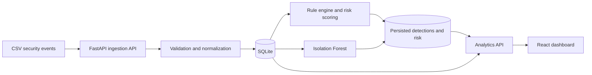

# CyberShield

## Cybersecurity Threat Detection & Risk Analytics Dashboard

CyberShield is an independent, educational full-stack portfolio project for
exploring cybersecurity event analytics. It ingests synthetic security events,
applies explainable rule-based detections and risk scoring, and uses a
batch-scoped Isolation Forest model to surface unusual-event signals in an
interactive dashboard.

The project demonstrates data ingestion, API design, persistence, analytics,
and visualization workflows relevant to cybersecurity analysis. It is **not a
production SIEM, a real-world threat detection system, or a substitute for
incident response**. All included security datasets are synthetic.

> **Project status:** Local development demo. No hosted deployment or
> production service is provided.

## Project overview and objectives

CyberShield is designed to demonstrate how structured event logs can be turned
into reviewable analytics:

- Validate and normalize CSV event data before analysis.
- Identify repeated events and avoid ingesting duplicates.
- Apply transparent, inspectable rules to calculate risk scores.
- Generate separate unsupervised anomaly signals with scikit-learn.
- Persist normalized events and findings in SQLite.
- Present event activity, rule detections, risks, anomalies, and evaluation
  results in a React dashboard.

The rule engine and ML detector are independent signals. ML results do not
change rule-based risk scores or establish that an event is malicious.

## Key features

- **CSV security-event ingestion and validation** — accepts UTF-8 CSV uploads
  with required columns, an explicit optional-column allowlist, row and upload
  limits, and field validation.
- **Duplicate detection** — fingerprints normalized event values and skips
  duplicates already present in the database.
- **Rule-based threat detection** — records matching detection names and
  supporting evidence.
- **Explainable risk scoring** — applies a transparent additive score and maps
  it to an event severity.
- **Isolation Forest anomaly detection** — produces batch-scoped anomaly
  signals for sufficiently large uploads.
- **Security analytics dashboard** — shows backend-loaded event metrics, trends,
  detections, risk distribution, model signals, and evaluation metrics.
- **Filtering and CSV export** — filters events by date and anomaly signals by
  severity and anomaly score; exports matching analytics to CSV.

## Technology stack

| Area | Technologies |
|---|---|
| Frontend | React, TypeScript, Vite |
| Visualization | Recharts |
| Backend API | Python, FastAPI, Pydantic |
| Data handling | Pandas, NumPy |
| Machine learning | scikit-learn, Isolation Forest |
| Persistence | SQLite, SQLAlchemy |
| Testing and linting | pytest, HTTPX, Ruff |
| Version control | Git, GitHub |

## Architecture



In the upload workflow, accepted event records and the derived rule/ML findings
are committed to SQLite. The dashboard retrieves analytics through the API.

## Prerequisites

- Windows with PowerShell
- Python 3.12 or later
- Node.js 20.19+ or 22.12+ and npm
- Git

SQLite is included with Python; a separate SQLite CLI is not required.
Scientific package installation depends on compatible prebuilt wheels for the
selected Python version. If installation fails, use a supported Python release.

## Windows installation

Open PowerShell at the repository root.

### 1. Set up the backend

```powershell
py -3 -m venv backend\.venv
backend\.venv\Scripts\python.exe -m pip install -e "backend[dev]"
```

The optional `dev` dependencies include pytest, HTTPX, and Ruff. Runtime
dependencies are declared in `backend\pyproject.toml`.

### 2. Install frontend dependencies

Open another PowerShell terminal at the repository root:

```powershell
Set-Location frontend
npm.cmd install
```

Use `npm.cmd` in PowerShell on Windows when the `npm` PowerShell script is
restricted by the execution policy.

## Start the application

Run the backend from the repository root:

```powershell
backend\.venv\Scripts\python.exe -m uvicorn app.main:app --reload --app-dir backend
```

In a second terminal, start the frontend:

```powershell
Set-Location frontend
npm.cmd run dev
```

Open the dashboard at <http://localhost:5173>. Vite proxies `/api` requests to
the local FastAPI service at `http://127.0.0.1:8000`.

### API documentation

FastAPI's interactive API documentation is available at
<http://127.0.0.1:8000/docs>.

The API currently exposes:

| Method | Endpoint | Purpose |
|---|---|---|
| `GET` | `/api/v1/health` | Basic service health |
| `POST` | `/api/v1/ingest` | Upload a CSV event file |
| `GET` | `/api/v1/dashboard/summary` | Dashboard summary metrics |
| `GET` | `/api/v1/dashboard/trends` | Event trends |
| `GET` | `/api/v1/events` | List events with supported filters and pagination |
| `GET` | `/api/v1/detections` | List rule-based detections |
| `GET` | `/api/v1/analytics/anomalies` | List filtered anomaly signals |
| `GET` | `/api/v1/analytics/evaluation` | Synthetic model evaluation |
| `GET` | `/api/v1/analytics/export.csv` | Export filtered analytics |

The SQLite database is created at `data\cybershield.sqlite3` on first run.

## Tests and production build

Run backend tests and Ruff from the repository root:

```powershell
backend\.venv\Scripts\python.exe -m pytest backend\tests
backend\.venv\Scripts\python.exe -m ruff check backend
```

The frontend build runs the TypeScript project check followed by the Vite
production build:

```powershell
Set-Location frontend
npm.cmd run build
```

## Dataset format and sample CSV

Uploads must be UTF-8 CSV files with a header row.

| Column | Requirement | Description |
|---|---|---|
| `event_time` | Required | ISO-8601 event timestamp; timezone-naive values are treated as UTC |
| `event_type` | Required | Event category, such as authentication or network |
| `outcome` | Required | Event result, such as success, failure, denied, or allowed |
| `source_ip` | Optional | Source address |
| `destination_ip` | Optional | Destination address |
| `username` | Optional | Associated user |
| `action` | Optional | Action associated with the event |
| `destination_port` | Optional | Integer destination port from 1 through 65535 |
| `bytes_transferred` | Optional | Non-negative finite byte count |
| `asset` | Optional | Related asset identifier or synthetic fixture label |

The API accepts only these columns, caps uploads at 5 MiB and 50,000 rows, and
reports invalid rows while skipping them. Duplicate normalized events are
ignored. Exported string fields are guarded against common spreadsheet formula
prefixes.

Use the included synthetic sample at `data\sample_events.csv`:

1. Start the backend and frontend using the commands above.
2. Open <http://localhost:5173>.
3. Select **Import event logs** and choose `data\sample_events.csv` from the
   repository.
4. Review the event metrics, detections, and risk analytics in the dashboard.

Uploads are stored in the local SQLite database. Re-uploading the same records
will be reported as duplicates rather than creating duplicate events.

### Included synthetic ML datasets

- `data\synthetic_ml_validation_events.csv` contains 100 synthetic rows (95
  normal-pattern and 5 unusual-pattern) with fixture labels in `asset`. It can
  be used to exercise the minimum upload batch size and anomaly-signal display.
- `data\ml_evaluation_train.csv` contains 240 unlabeled normal-pattern training
  rows.
- `data\ml_evaluation_test.csv` contains a separate fixed test split of 90
  normal and 10 labeled unusual-pattern rows. The evaluation service removes
  the `is_anomaly` label before constructing model inputs.

These are synthetic fixtures, not representative, independently validated
cybersecurity benchmarks.

## Rule-based detection and risk methodology

The rule engine adds points when these conditions are met:

| Condition | Points |
|---|---:|
| Authentication event with outcome `failure`, `failed`, or `denied` | 30 |
| Privileged or destructive action (`delete`, `disable`, `grant_admin`, or `privilege_escalation`) | 40 |
| Remote-administration destination port (`22`, `3389`, or `445`) | 15 |

The score is capped at 100 and mapped to severity:

| Score | Severity |
|---:|---|
| 0 | Informational |
| 1–29 | Low |
| 30–59 | Medium |
| 60–84 | High |
| 85–100 | Critical |

Matched rule names and evidence are persisted with detections. These starter
rules are illustrative; they should not be treated as a complete threat model
or used as an operational security policy.

## Isolation Forest methodology

The ingestion model is versioned as `isolation-forest-v2`. It runs on each
upload's accepted, nonduplicate events when at least 20 events are available.
Smaller batches report `insufficient_data`; they do not silently substitute a
model result.

The deterministic model uses 100 trees, a fixed random seed of 42, and 10%
contamination. Its features include log-transformed byte volume, destination
port and port-presence, outcome and event-type indicators, a sensitive-action
indicator, and cyclic time-of-day values. The model is fit and scored within
each upload batch. Only flagged rows are stored in `anomaly_signals`.

An anomaly decision score is model-relative (lower scores are more unusual);
it is not the rule-based 0–100 risk score. Model signals do not change rule
scores or severity and are leads for human review, not confirmed malicious
activity.

## Synthetic ML evaluation

The dashboard evaluation uses the fixed, separate split described above:
240 unlabeled training records and 100 test records (90 normal, 10 anomalous).
Test labels are removed before feature extraction and used only to calculate
metrics. The three Isolation Forest experiments use 100 trees and random seed
42, changing only the contamination value.

| Experiment | Predicted anomalies | Precision | Recall | F1-score | Confusion matrix |
|---|---:|---:|---:|---:|---|
| Isolation Forest, 5% contamination | 5 | 0.200 | 0.100 | 0.133 | `[[86, 4], [9, 1]]` |
| Isolation Forest, 10% contamination (selected) | 15 | 0.333 | 0.500 | 0.400 | `[[80, 10], [5, 5]]` |
| Isolation Forest, 15% contamination | 24 | 0.250 | 0.600 | 0.353 | `[[72, 18], [4, 6]]` |
| Rule-based baseline | 0 | 0.000 | 0.000 | 0.000 | `[[90, 0], [10, 0]]` |

For each matrix, rows are actual classes (normal, anomaly) and columns are
predicted classes (normal, anomaly). The rule-based baseline applies the
existing `assess_event` logic unchanged; none of these synthetic test records
matched those rules. The two detector results are compared, not combined.

The 10% setting is used by `isolation-forest-v2` because it had the highest
F1-score among these three experiments on this split. Its recall is higher than
the 5% experiment, but it also produces more false positives. This is a
measured result for this fixed synthetic data—not evidence of high accuracy or
expected performance on real security events.

The test anomaly rows have `log1p(bytes_transferred)` from 19.34 to 19.98,
compared with a normal range of 6.22 to 9.38, and scaled destination ports
around 0.946, compared with normal values at or below 0.0068. Outcome,
event-type, and action indicator features are identical across these classes.
The synthetic normal test rows also span 00:00–07:25, while training spans the
full day; this distribution shift can contribute to false positives.

**Evaluation limitations:** The dataset is small, deliberately synthetic, and
represents one fixed split. Because the 10% setting was selected after comparing
results on this test split, the test data is no longer an independent final
estimate of that selected setting's performance. A new, independently labeled
validation set is required before drawing broader performance conclusions or
tuning for operational use. The metrics do not establish precision, recall, or
effectiveness on real cybersecurity traffic or another organization's
environment. Do not treat either rule or model results as confirmed incidents.

## Screenshots

No screenshots are included yet. Add genuine captures of the running
application to a project screenshots directory when available.

- **Dashboard overview:** _Placeholder — add an actual overview screenshot._
- **Security events and filters:** _Placeholder — add an actual events screenshot._
- **Detections and risk analytics:** _Placeholder — add actual analytics screenshots._
- **ML evaluation:** _Placeholder — add an actual evaluation screenshot._

## Security considerations and project limitations

- This is an independent educational portfolio project using synthetic security
  data. It is not a production SIEM or real-world threat detection service.
- The development API has **no authentication**. Do not expose it to untrusted
  networks or deploy it as a shared multi-user service.
- SQLite is configured for a local development/demo workflow. The application
  does not provide production access control, multi-user isolation, or an
  operational incident-response process.
- Do not upload real or sensitive security logs unless the environment and
  storage location are explicitly approved to handle them. The database is
  stored locally under `data`; check device backup and synchronization policies.
- Rule thresholds are illustrative and incomplete. ML signals are
  unsupervised, batch-scoped, and limited by the synthetic evaluation.
- The evaluation results must not be generalized to real-world model performance.

## Future improvements

Potential future work—not implemented in the current project:

- Validate on larger, independently labeled datasets representative of a
  clearly defined use case.
- Add authentication, authorization, and deployment hardening before any
  multi-user or network-accessible use.
- Expand event schemas and detection rules with domain-specific validation.
- Add dashboard pagination and additional analysis workflows for larger data.
- Improve monitoring, audit logging, retention, and database migration support.

## Repository

[View CyberShield on GitHub](https://github.com/Vamsikrishna0304/CyberShield)
